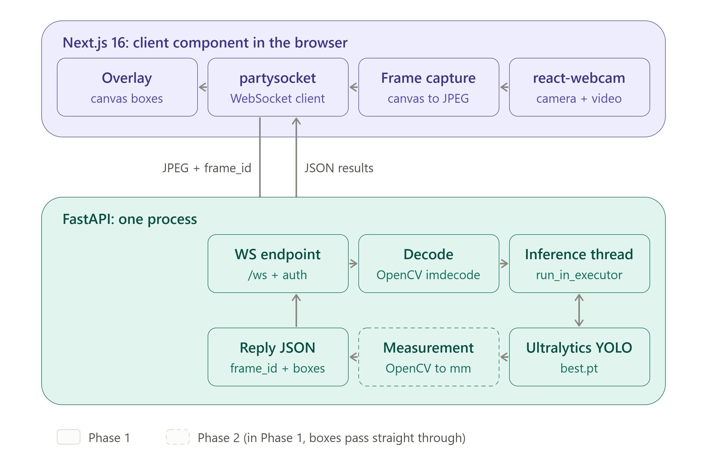

# Live object detection (Scan page)

The browser webcam sends frames over a WebSocket. FastAPI runs a built-in Ultralytics YOLO model and sends back boxes, which the Scan page draws over the video. Phase 2 turns a box into a carapace width in mm.

- **Decision record:** [ADR-0003](../adr/0003-live-object-detection-over-websocket.md)
- **Diagram:** [`plan.png`](plan.png)
- **Status:** Phase 1 (boxes) and Phase 2 (width from the box, scaled by the 40 mm sticker or, without it, the 12 in stand) built. Phase 2b (contour width) and the caliper check are not done.



## 1. Flow

```
Browser (Scan page, client components)
  react-webcam ─▶ use-frame-capture (canvas → JPEG, long side ≤ 640, one frame in flight)
               ─▶ use-detection-socket (partysocket) ──wss <web origin>/ws/detections──┐
  custom-detection-overlay ◀── DetectionResult (zod) ◀────────────────────────────────┤
  startDetection Server Action ──BFF client (Bearer from cookie)──▶ POST /detections/tickets
                                                                                      │
Next.js server: next.config.ts rewrite /ws/detections → ${API_URL}${API_PREFIX}/detections/ws
                                                                                      ▼
FastAPI (one process)
  WS /detections/ws
    1. check Origin → accept → wait ≤ 5 s for the auth message → verify the ticket
    2. receive loop: binary [u32 frame_id][JPEG] → keep only the latest frame
    3. infer loop: cv2.imdecode → YoloDetector.infer (single-thread executor)
                   → Phase 2: measurement → send result JSON
    4. close with 4001 when the access token behind the ticket expires
```

Nothing is written to the database. A width is saved only when the user saves the crab log (`POST /logs`).

## 2. Model

- **Built-in pretrained model:** `yolo11n.pt` (Ultralytics, the 80 COCO classes, about 5 MB, fast on CPU).
- Ultralytics downloads it on the first load into `api/ml/models/` (gitignored).
- Labels come from `model.names`, so they're everyday objects (`person`, `cup`, `bottle`, …), not crabs.
- `yolo_classes` can limit which labels are returned. `None` returns all of them.
- A custom crab model later is only a settings change: point `yolo_weights` at the new `.pt`.

## 3. Protocol

### Ticket

`POST /api/v1/detections/tickets` (every role) → `201`, envelope `details: {ticket, expires_at}`.

The ticket is a JWT signed with `jwt_secret_key`:

| Claim | Value |
|---|---|
| `type` | `"detection"` (an access or refresh token is refused) |
| `sub`, `role`, `email` | copied from the caller's access token |
| `jti` | random UUID, consumed once (in-process TTL set) |
| `exp` | now + `detection_ticket_seconds` (30) |
| `session_exp` | the caller's access-token `exp`. The socket closes then |

### Client to server

| Message | Format |
|---|---|
| auth (first, within `detection_auth_timeout_seconds`) | text `{"type":"auth","ticket":"…"}` |
| frame | binary: 4-byte big-endian `frame_id` followed by JPEG bytes, at most `detection_max_frame_bytes` |

### Server to client

Text JSON, a union on `type` (Pydantic on the server, zod on the client):

```jsonc
{"type":"ready","model":"yolo11n.pt","image_size":640}
{"type":"result","frame_id":42,"width":640,"height":480,"inference_ms":38,
 "boxes":[{"x1":0.12,"y1":0.30,"x2":0.55,"y2":0.71,"confidence":0.91,"label":"cup"}]}
{"type":"error","code":"BAD_FRAME","message":"That frame couldn't be read"}
```

- Box coordinates are normalized (0–1) to the frame that was sent.
- `result.measurement` is `{"width_mm":96.4,"mm_per_px":0.3351,"box_index":0,"scale_source":"sticker","fov_deg":70.3}` (corners normalized like the boxes), or `null` when there are no boxes. The measured box is always the **most confident** one.
- An `error` message leaves the socket open.

### Close codes

| Code | Meaning | Client action |
|---|---|---|
| 4001 | Session expired (the access token behind the ticket) | Get a new ticket and reconnect. If the action returns 401, `router.refresh()` and the page goes to `/pin` |
| 4401 | Bad, used or expired ticket, or no auth message in time | Same as 4001, once. Then show an error |
| 4403 | `Origin` not allowed | Show an error, no retry |
| 4413 | Frame larger than `detection_max_frame_bytes` | Lower the JPEG quality and continue |
| 1013 | Model not loaded, or `detection_max_sessions` reached | Back off and retry (partysocket's exponential delay) |

### Backpressure

- The client keeps **one frame in flight**: it sends the next one only after the matching `result`, and captures at most `MAX_FPS = 8`.
- The server keeps a **one-slot latest-frame buffer**. A newer frame replaces an older one that hasn't been processed, so nothing queues.

## 4. Backend layout (`api/`)

```
app/infrastructure/vision/        # technical only, no domain imports
├── __init__.py                   # re-exports through __all__
├── detector.py                   # YoloDetector: load() (+ warm-up), async infer(image), is_ready, close()
├── codec.py                      # decode_jpeg(bytes) -> ndarray | None   (cv2.imdecode)
├── measurement.py                # find_qr_side_px, mm_per_pixel, fov_from_scale, measure_width (detector thread)
└── results.py                    # RawBox, Measurement, Inference

app/artificial_intelligence/      # domain
├── __init__.py  api.py           # ROUTERS
└── vision/                       # resource; no models layer: nothing is stored
    ├── __init__.py
    ├── router.py                 # POST /detections/tickets, WS /detections/ws
    ├── schemas.py                # DetectionTicketRead, DetectionBox, DetectionMeasurement,
    │                             # DetectionAuthMessage, Detection{Ready,Result,Error}Message
    ├── services.py               # DetectionServices: issue_ticket(actor), run_session(ws, detector, user)
    └── dependencies.py           # LiveDetector (503 / 1013), TicketAuth, allowed_origin
```

- **`main.py` lifespan:** build `YoloDetector`, then `await run_in_threadpool(detector.load)`. On failure, log it and set `app.state.detector = None`. Shut the executor down on exit. Register the domain's `ROUTERS` (`AI_ROUTERS` in `main.py`).
- **Ticket endpoint:**
  - The router declares `dependencies=[Depends(get_current_user)]`, and the endpoint takes `actor: AnyRole` and `rate_limit("detection_ticket")`.
  - Issuing a ticket isn't a state change, so it isn't audited. A rejected ticket is audited as `detection.ticket_rejected` through `core.audit`, or logged if `AuditServices.record` can't take a `WebSocket`.
- **The WebSocket endpoint has no Bearer dependency.** It authenticates with the ticket inside `DetectionServices.run_session`. That function runs a receive task and an infer task under `asyncio.wait(FIRST_COMPLETED, timeout=<session left>)` and enforces `session_exp` and `detection_max_sessions`.
- **Dependencies:** `ultralytics` (brings `opencv-python` and `numpy`), `websockets` (uvicorn's WebSocket support), and `torch`/`torchvision` from the CPU wheel index (Poetry source `pytorch-cpu`). They carry a `python` marker that skips 3.14.1, which torchvision doesn't support.

### Settings (`core/config.py`)

| Key | Default | Meaning |
|---|---|---|
| `yolo_weights` | `yolo11n.pt` | Built-in model name (downloaded) or a path to custom weights |
| `yolo_weights_dir` | `ml/models` | Download cache, gitignored |
| `yolo_classes` | `None` | Optional label filter |
| `yolo_image_size` | `640` | Inference size |
| `yolo_confidence` | `0.4` | Minimum confidence |
| `yolo_device` | `cpu` | Torch device |
| `yolo_threads` | `2` | `torch.set_num_threads` |
| `detection_ticket_seconds` | `30` | Ticket lifetime |
| `detection_auth_timeout_seconds` | `5` | Time to send the auth message |
| `detection_max_frame_bytes` | `600000` | Largest accepted frame |
| `detection_max_sessions` | `4` | Open sockets per process |
| `detection_ticket_rate_limit` | `30` | Tickets per client IP per minute (`rate_limit`) |
| `detection_allowed_origins` | the web origin | Accepted `Origin` headers |

## 5. Web layout (`web/`)

- **`next.config.ts`:** `rewrites().beforeFiles: [{ source: '/ws/detections', destination: `${API_URL}${API_PREFIX}/detections/ws` }]`. `lib/env.ts` is `server-only`, so the root `.env` parsing moves to `lib/root-env.ts`, which both `env.ts` and `next.config.ts` import.
- **`proxy.ts`:** the matcher also skips `ws/`.
- **Scan domain** (`app/(protected)/(portal)/scan/`):
  - `api/detection-api.ts`: `detectionApi.createTicket()`
  - `actions/start-detection.ts`: Server Action, returns `ActionResult<{ticket, expires_at}>`
  - `types/detection.ts`: zod for the server union and `DetectionBox`
  - `lib/frame-codec.ts`: `encodeFrame(frameId, jpeg)`, `coverTransform(video, box)` (maps normalized boxes through `object-cover` cropping)
  - `components/use-detection-socket.ts`: partysocket. On `open` it gets a ticket and sends auth. It handles the close codes and returns `{status, result, sendFrame}`
  - `components/use-frame-capture.ts`: `requestVideoFrameCallback` → offscreen canvas → `toBlob('image/jpeg', 0.7)` → `sendFrame`, one in flight
  - `components/custom-detection-overlay.tsx`: an `aria-hidden` canvas over the `<Webcam>`, plus a visible `role="status"` line ("Cup found · 91%")
- **Scan flow:** live detection (socket plus box overlay) runs whenever the camera is on, so a box appears as soon as something is detected. QR reading runs alongside it until a sticker is read. After that, the status line also lists what's in view. Stopping the camera closes the socket. With more than one camera, a **Camera** select switches the stream: detection reconnects with a new ticket, and the choice is remembered on that device.
- **Dependency:** `partysocket`.

## 6. Phase 2: width in mm (fixed stand + 40 mm sticker)

The camera sits on a **fixed stand, 12 in (304.8 mm) above the crab**, pointing straight down. The width is the most confident box's **horizontal** (left-to-right) span × a scale in mm per pixel. The scale comes from one of two sources (`infrastructure/vision/measurement.py`, `measure_width`):

1. **The crab's sticker, when its QR is in view (preferred).** Stickers are 40 mm (`detection_sticker_mm`), and the QR is printed at `QR_SHARE = 0.62` of that with no quiet zone, so 24.8 mm. `scale = 24.8 ÷ QR side in px`. The sticker sits on the shell, so it's in the same plane as the width being measured, and crab height doesn't skew it.
2. **The stand, when no QR is found.** `scale = 2 × detection_camera_distance_mm × tan(detection_camera_fov_deg ÷ 2) ÷ frame long side in px`. Defaults: 304.8 mm (12 in) and **51.4°**, calibrated on the farm's stand camera (the 69° phone-camera guess read about 30% high).
   - **Calibration history:** a keyboard truly 292.1 mm wide read 380 mm with 69° → 55.7°. Then a phone about 164.1 mm long (162.2–166) read 180 mm with 55.7° → `2 × atan(tan(55.7° ÷ 2) × 164.1 ÷ 180) = 51.4°`. The two objects disagree by about 8% because their tops sit at different heights (keyboard about 28 mm, phone about 8 mm) and their boxes fit differently, so calibrate with something flat at the height of a crab's shell.
   - **Distance is lens to the top of the measured object** (the shell), not the tray: a keyboard top about 28 mm above the desk is about 277 mm from the lens, and reads about 10% bigger if 304.8 is kept. Measure it on the stand and set `DETECTION_CAMERA_DISTANCE_MM`.

- **Correction:** `detection_width_offset_mm` (default **−5 mm**, from the stand test phone) is added to every width after scaling: `width = box_px × mm_per_px + offset`, never below 0. It's a fixed amount, so it suits a fairly constant size range like crabs. A size-proportional error belongs in the angle or distance instead. The panel shows it as its own step.
- **Self-calibration:** with the sticker in view, the result also reports `fov_deg`, the field of view that the sticker's scale implies at 12 in. The Scan status line shows it ("sticker scale (camera 70.3°)"). Put that number in `.env` as `DETECTION_CAMERA_FOV_DEG` once per camera model, and the stand fallback matches the sticker. Synthetic check: true 73°, read 74.1°. A 100 mm box read 102.0 mm via the sticker, and 100.0 mm via the calibrated stand.
- **Frame size:** at 12 in, the 24.8 mm QR is only about 36 px wide in a 640 px frame, too small for OpenCV. The page sends frames up to **1280 px** on the long side (about 210 KB JPEG), giving about 72 px. YOLO still runs at `yolo_image_size` (640). Processing is about 100 ms per frame, or about 190 ms when a QR is searched and found.
- **Limits:** the camera must point straight down at 1× zoom. Keep the crab near the centre (lens distortion) and lined up left to right, since boxes are upright, so a diagonal crab reads wide. With no sticker, the stand scale assumes the 12 in is lens-to-shell.
- **Precision:** the API sends exact values (no rounding), and the median and steadiness use them as they are. Widths are rounded to **2 decimals** only when shown or put in the form (`scan/lib/format-mm.ts`, `formatMm`), matching the form's 2-decimal limit.
- **Client:** keep a rolling median of the last 7 widths (`use-steady-width.ts`). After a sticker is read, the median writes into **Width (mm)** live. The hint says "Live from the camera · steady" (spread of 1.5 mm or less) or "· hold still". Typing in the field stops live updates, and a "Use the camera's … mm" link turns them back on.

## 7. Build order

1. Docs: this file, ADR-0003, context updates.
2. `feat(api): add YOLO detector infrastructure`
3. `feat(api): add detection tickets and websocket`
4. `feat(web): proxy detection websocket through next rewrite`
5. `feat(web): show live detection boxes on the scan camera`
6. Phase 2: `feat(api): measure carapace width from the stand's camera geometry`, `feat(web): prefill width from the live measurement`

## 8. Verification

- **API:**
  - The first start downloads `yolo11n.pt`. When offline with no cache, the API still starts and the socket closes with 1013.
  - A ticket without a Bearer gets 401. A reused ticket closes with 4401. Waiting 31 s gives 4401.
  - A `websockets` smoke script sends auth plus a JPEG of a cup or person, and gets a `result` with the same `frame_id`.
  - A garbage frame gives `BAD_FRAME` with the socket open. An oversized frame gives 4413. A bad `Origin` gives 4403. A 5th session gets 1013.
  - `GET /health` stays under 100 ms while a session streams.
- **Web:**
  - `npm run lint` and `npx tsc --noEmit` pass.
  - On `/scan`, read a sticker, then labelled boxes track objects on a laptop and a phone. The phone needs https (`next dev --experimental-https` or a tunnel).
  - DevTools → WS shows `/ws/detections` on the web origin, with no JWT in the URL or the frames.
  - Past the access-token expiry, the socket closes with 4001 and reconnects with a new ticket, or the page goes to `/pin`.
